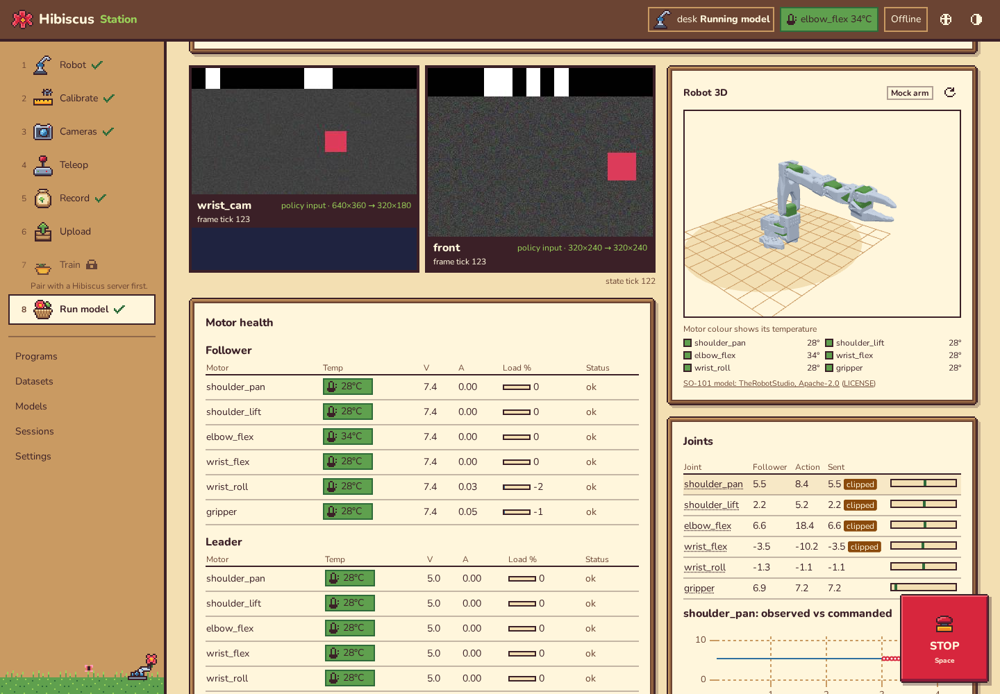
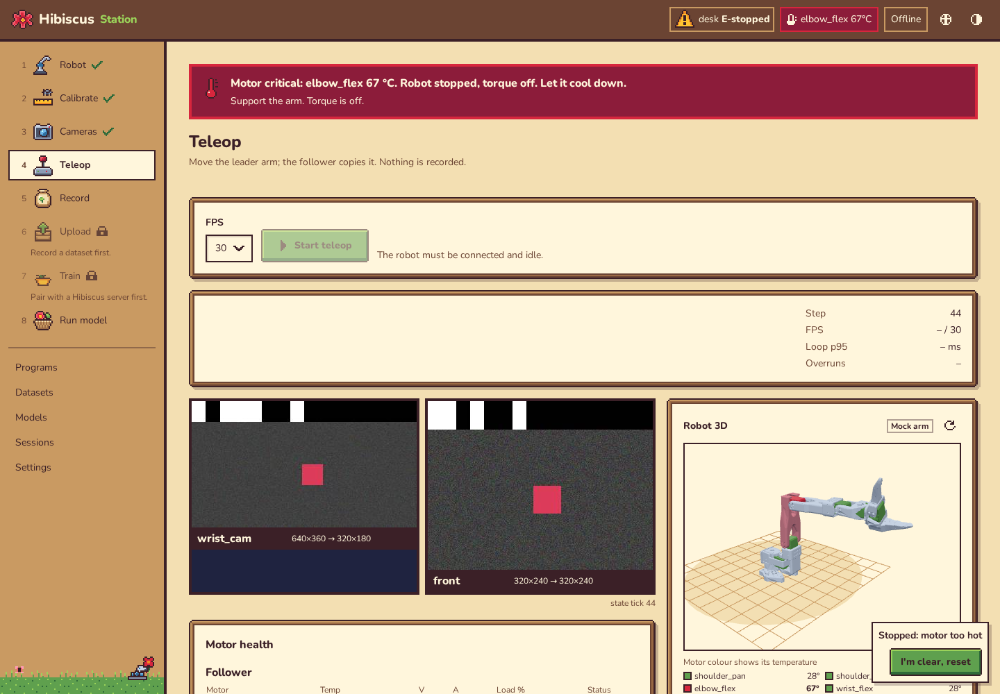
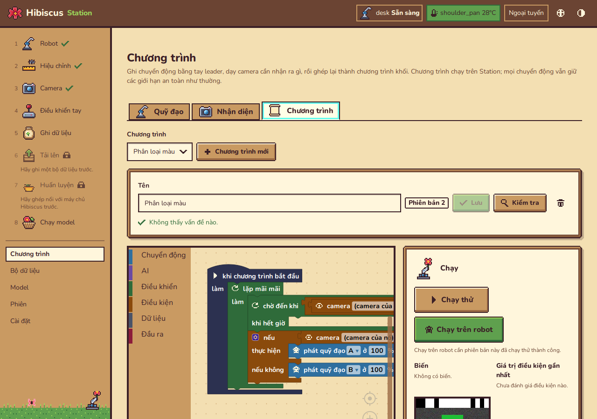
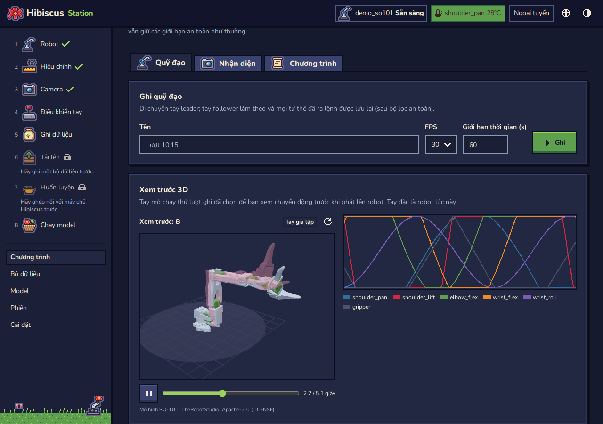
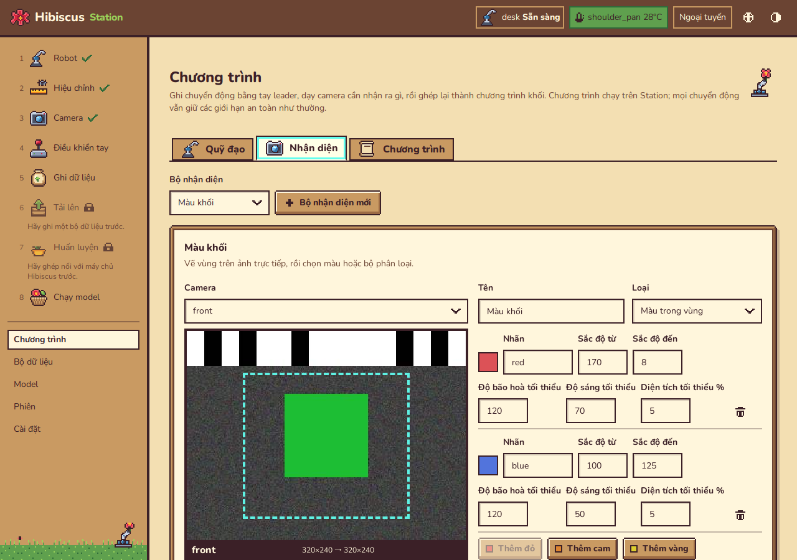
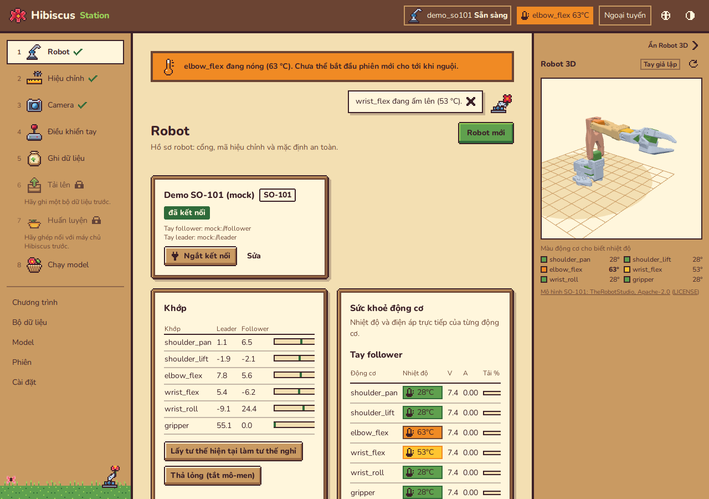

<div align="center">

# 🌺 Hibiscus Station

**English** · [Tiếng Việt](README.vi.md)

[](https://github.com/Bigkatoan/hibiscus-station/actions/workflows/ci.yml)
[](https://github.com/Bigkatoan/hibiscus-station/actions/workflows/codeql.yml)
[](LICENSE)
[](https://www.python.org/downloads/release/python-3120/)
[](https://github.com/Bigkatoan/hibiscus-station/pkgs/container/hibiscus-station)
[](https://github.com/huggingface/lerobot)
[](https://github.com/TheRobotStudio/SO-ARM100)

</div>

**Hibiscus Station** is the app that runs on the computer next to your robot arm. It connects an
SO-100 / SO-101 follower and leader, calibrates them, adds cameras, teleoperates, records
[LeRobot](https://github.com/huggingface/lerobot) datasets, uploads them to a
[Hibiscus](https://github.com/Bigkatoan/Hibiscus) training server, pulls the trained model back and
**runs it on the robot**, with every camera and every motor temperature on screen. It also lets you
program the arm without training at all: record motions with the leader arm, teach a camera what
to look for, and chain them in a block editor.

It runs on an x86_64 PC or mini PC (optionally with an NVIDIA GPU), an NVIDIA Jetson Orin
(JetPack 6) or a Raspberry Pi 5, from a Docker image or a Python wheel, and on Windows 10/11 and
macOS from the wheel.

## What it does

* **Motor health on every screen that moves the arm.** Temperature, voltage, current, load and the
  alarm flags of every servo, follower and leader, read inside the control loop without slowing it.
  Warm at 50 °C, hot at 60 °C (no new session), critical at 65 °C twice in a row: Station holds the
  arm, parks it at your rest pose and turns the torque off before the servo's own 70 °C cutoff drops
  it.
* **Cameras while a model runs.** One owner per camera feeds both the control loop and the UI, so
  you see the exact frames the policy received, tagged with the control tick, next to joints vs.
  commanded actions, FPS and inference latency.
* **The whole data loop.** Robot profiles with "find the port by unplugging" or "by moving the arm",
  lerobot-compatible calibration, LeRobot v3 recording with → / ← / Esc, resumable upload to a
  Hibiscus workspace, model import or pull with a compatibility check, runs with a dead-man switch,
  a per-step motion cap and a Space-bar e-stop.
* **Trajectories and block programs.** Record a follower motion with the leader, trim it, preview
  it on a see-through 3D arm, replay it at 10-150 %. Camera detectors (colour in a region, or an ONNX
  classifier), operator buttons, joint and temperature conditions, HTTP and MQTT signals. A
  Blockly editor in the Hibiscus theme; a dry run on a simulated arm before the first real run.
* **3D twin.** The SO-101 drawn live from its joint positions, each motor coloured by temperature.
* **Bilingual pixel UI** (Tiếng Việt and English, day and night), served by Station itself: no Node
  on the robot computer.

<table>
  <tr>
    <td width="50%"><br><sub><b>Run model</b>: the policy's camera frames, 3D twin, motor health, clipped joints</sub></td>
    <td width="50%"><br><sub><b>Thermal safe stop</b>: hold, park, torque off, reset once cool</sub></td>
  </tr>
  <tr>
    <td width="50%"><br><sub><b>Programs</b>: camera sees red → trajectory A, otherwise B (Vietnamese UI)</sub></td>
    <td width="50%"><br><sub><b>Trajectory preview</b>: the ghost arm plays the take before the robot does (night)</sub></td>
  </tr>
  <tr>
    <td width="50%"><br><sub><b>Detection</b>: colour-in-region rules on the live frame</sub></td>
    <td width="50%"><br><sub><b>3D twin</b>: a hot elbow motor in orange, live joints</sub></td>
  </tr>
</table>

## Quick start

Station runs on **Linux** (Docker or the Python package), **Windows 10/11** and macOS (the Python
package, see [Windows](#windows-1011) below). The Docker deploy is Linux only: Docker Desktop on
Windows or macOS cannot hand a USB serial port to a container (short of usbipd + WSL), so use the
wheel there.

Read [docs/deploy.md](docs/deploy.md) for the details. On a Linux robot computer, as your normal user:

```bash
curl -fsSLO https://raw.githubusercontent.com/Bigkatoan/hibiscus-station/main/deploy/install.sh
less install.sh && bash install.sh
```

| Your machine | What `install.sh` picks | First-boot checklist |
|---|---|---|
| x86_64 PC / mini PC | `ghcr.io/bigkatoan/hibiscus-station:0.2.1-cpu` | - |
| x86_64 + NVIDIA GPU | `…:0.2.1-cuda` (needs the NVIDIA Container Toolkit) | - |
| Jetson Orin, JetPack 6 | `…:0.2.1-jetson` (NVIDIA runtime) | [first-boot-jetson.md](docs/first-boot-jetson.md) |
| Raspberry Pi 5 | `…:0.2.1-cpu` (arm64) | [first-boot-pi5.md](docs/first-boot-pi5.md) |

Then open the printed link on that machine (`hibiscus-station-ctl url` prints it again). From a
laptop: `ssh -N -L 18210:127.0.0.1:18210 you@robot-pc` and open the same link. Station listens on
127.0.0.1 only; [LAN mode](docs/deploy.md#open-station-on-the-lan-opt-in) is opt-in.

Without Docker (Python 3.12 via [uv](https://docs.astral.sh/uv/)):

```bash
uv tool install https://github.com/Bigkatoan/hibiscus-station/releases/download/v0.2.5/hibiscus_station-0.2.5-py3-none-any.whl
# no NVIDIA GPU (Pi 5, most mini PCs): add --torch-backend cpu
hibiscus-station --mock          # demo without hardware (simulated arms, data in ~/.hibiscus/station-demo)
hibiscus-station                 # with the arms plugged in
hibiscus-station doctor          # something wrong? writes a report zip to send us
```

A systemd user unit for this install is in [deploy/systemd/](deploy/systemd/hibiscus-station.service).

### Windows 10/11

In PowerShell (x64, no admin rights needed):

```powershell
powershell -ExecutionPolicy ByPass -c "irm https://astral.sh/uv/install.ps1 | iex"   # uv, once
uv tool install --python 3.12 https://github.com/Bigkatoan/hibiscus-station/releases/download/v0.2.5/hibiscus_station-0.2.5-py3-none-any.whl
# no NVIDIA GPU: add --torch-backend cpu
hibiscus-station --mock          # demo without hardware (simulated arms, data in ~/.hibiscus/station-demo)
hibiscus-station                 # with the arms plugged in; the browser opens by itself
hibiscus-station doctor          # something wrong? writes a report zip to send us
```

* **Close LeLab (and any lerobot script) first.** On Windows a COM port and a camera have one owner:
  while another program holds them Station reports the port as busy.
* **Serial driver.** The SO-100/SO-101 servo boards use a WCH CH340 or CH343 USB-serial chip. When
  Device Manager shows no new *Ports (COM & LPT)* entry after plugging the board in, install the WCH
  driver (CH341SER for CH340, CH343SER for CH343) from wch-ic.com and plug it in again.
* **Ports are `COM3`, `COM4`...** Use *Robots → Find port* (unplug flow) to tell the leader from the
  follower. The number sticks to the adapter (or the USB socket); to pin one, Device Manager → the
  port → Port Settings → Advanced → COM Port Number.
* **Cameras are numbers** (`0`, `1`, ...; a laptop webcam is usually `0`) and can change when you plug
  cameras into other USB sockets: check them on the Cameras page after re-plugging. Close apps that
  use the camera (Camera, Teams, OBS) and allow *Settings → Privacy → Camera → desktop apps*.
* Data lives in `%USERPROFILE%\.hibiscus\station`; calibration in
  `%USERPROFILE%\.cache\huggingface\lerobot\calibration`, shared with LeLab and lerobot.

Day to day with Docker:

```bash
hibiscus-station-ctl status | logs -f | url | ports
hibiscus-station-ctl backup                 # profiles, calibration, trajectories, programs, detectors
hibiscus-station-ctl update 0.2.1-cpu       # backup, pull, restart, health check, auto-rollback
hibiscus-station-ctl rollback
```

## Using it

* User guide: [English](docs/user-guide/en/station.md) · [Tiếng Việt](docs/user-guide/vi/station.md)
* **Before relying on it, run the hardware checklist** on your arms:
  [English](docs/user-guide/en/station-hardware-uat.md) ·
  [Tiếng Việt](docs/user-guide/vi/station-hardware-uat.md). Every automated test runs on mock
  motors, mock cameras and a tiny policy; the checklist covers what only real hardware can show.
* The e-stop is software. Keep a way to cut the arm's power by hand.

## Talking to a Hibiscus server

Station pairs with a [Hibiscus](https://github.com/Bigkatoan/Hibiscus) server with a personal access
token (`datasets:write`, `models:read`, optionally `runs:read`). It never trains on the robot
computer: it uploads datasets and pulls trained model bundles through the `hibiscus` CLI package,
pinned to the server's `v0.1.1` API (`/api/v1`). The tests check every request against that
contract ([tests/contract/](tests/contract/README.md)).

## Development

```bash
git clone https://github.com/Bigkatoan/hibiscus-station.git && cd hibiscus-station
make help                 # every target
make check                # ruff, mypy --strict, pytest; web: eslint, prettier, tsc, vitest
make web wheel            # build the UI (Node 22 in Docker if you have no Node), then the wheel
make image VARIANT=cpu    # docker/build.sh cpu
make e2e                  # Playwright drives the built UI against hibiscus-station --mock
```

Layout: `hibiscus_station/` (FastAPI app, hardware owner thread, sessions, programs, mocks),
`web/` (Vite + React UI, bundled into the wheel), `tests/`, `docker/`, `deploy/`, `docs/`
([spec](docs/spec/station.md), [programs spec](docs/spec/station-programs.md)). See
[CONTRIBUTING.md](CONTRIBUTING.md).

## License

Hibiscus Station is free software under the [GNU AGPL v3.0](LICENSE) (or later). The Hibiscus
artwork (pixel art, the mascot Hibi, the logo, icons and favicons) is © Bigkatoan, all rights
reserved, and licensed separately in [ASSETS-LICENSE](ASSETS-LICENSE). Nunito is under the SIL Open
Font License 1.1; the SO-101 model is TheRobotStudio's, under Apache-2.0. See [NOTICE](NOTICE).
