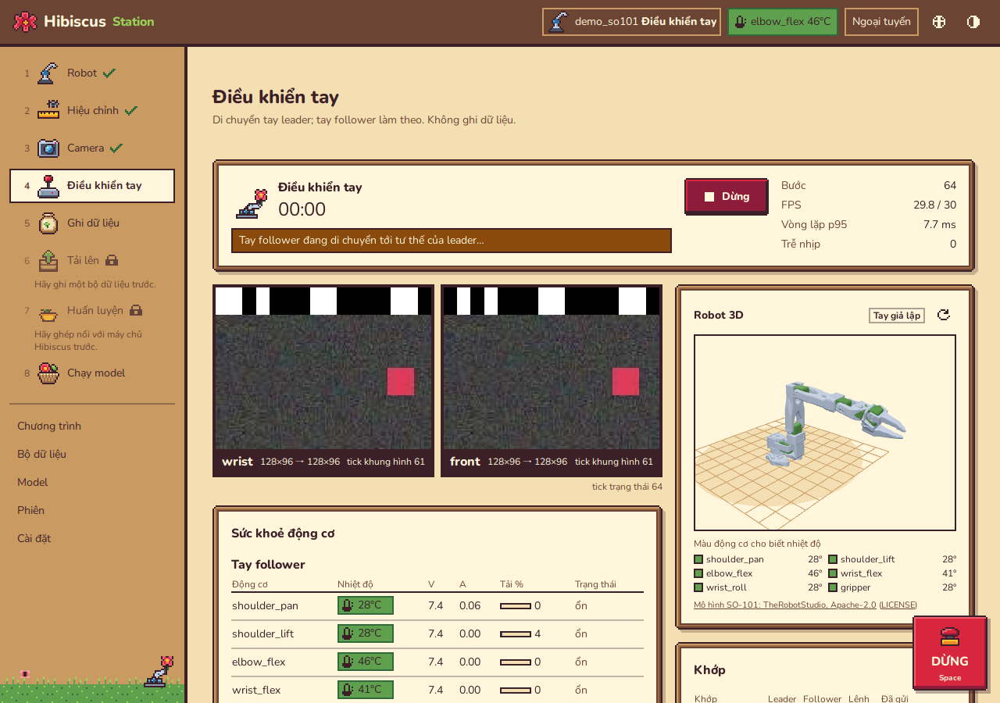
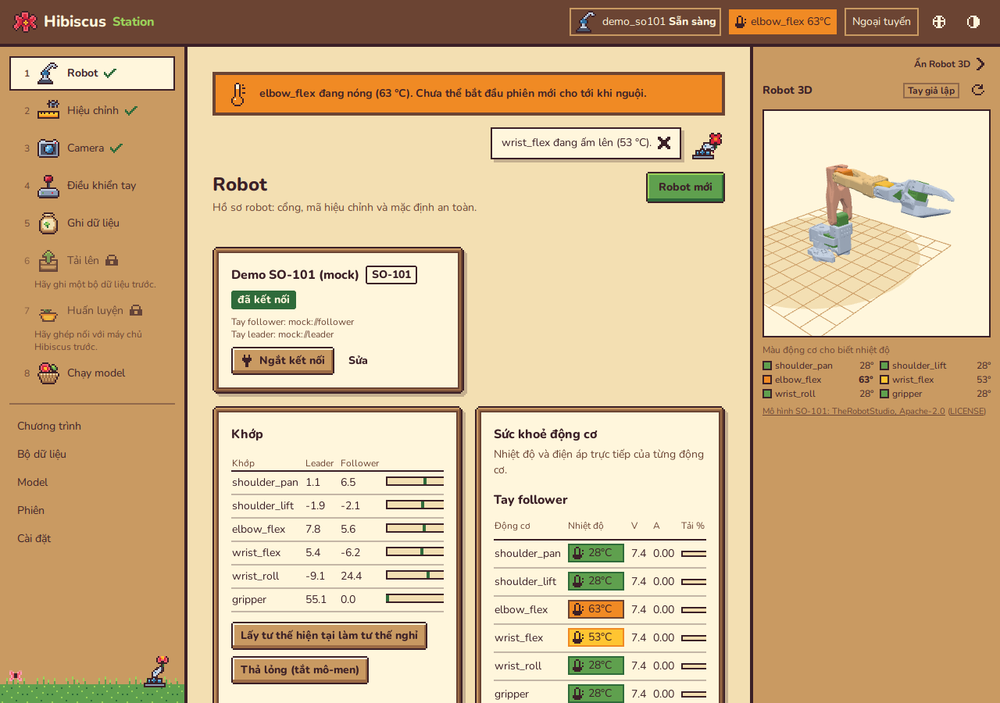
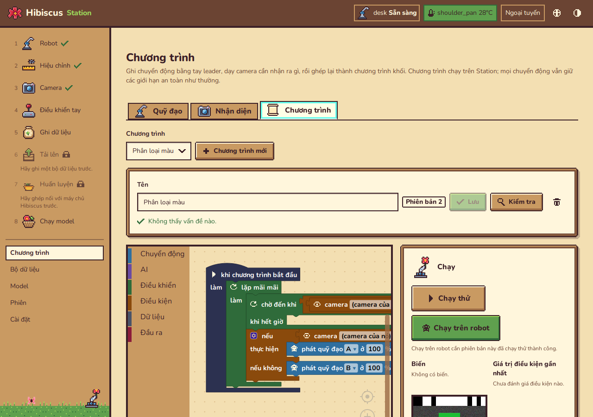
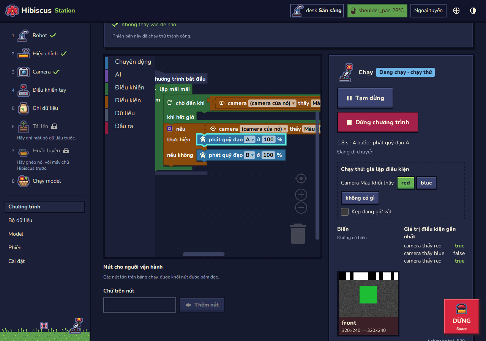
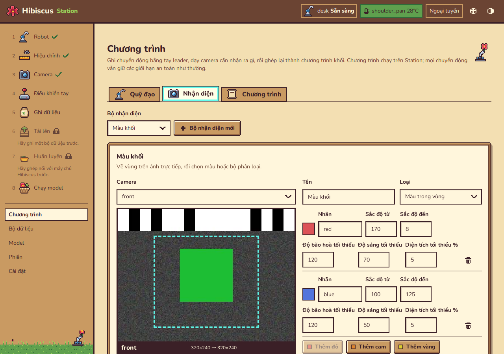
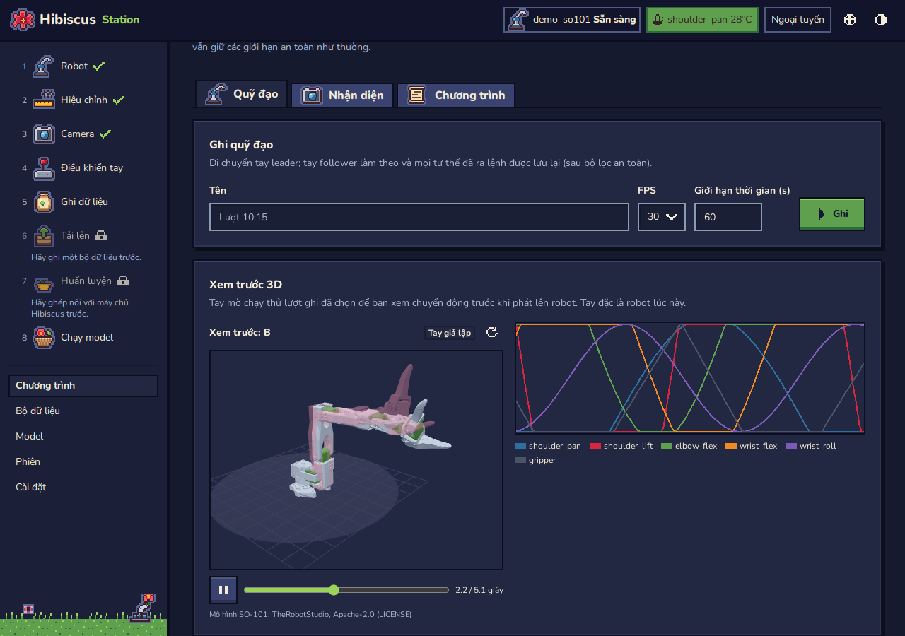

<div align="center">

# 🌺 Hibiscus Station

[English](README.md) · **Tiếng Việt**

[](https://github.com/Bigkatoan/hibiscus-station/actions/workflows/ci.yml)
[](https://github.com/Bigkatoan/hibiscus-station/actions/workflows/codeql.yml)
[](LICENSE)
[](https://www.python.org/downloads/release/python-3120/)
[](https://github.com/Bigkatoan/hibiscus-station/pkgs/container/hibiscus-station)
[](https://github.com/huggingface/lerobot)
[](https://github.com/TheRobotStudio/SO-ARM100)

</div>

**Hibiscus Station** là ứng dụng chạy trên máy tính đặt cạnh tay robot. Nó kết nối tay follower và
leader SO-100 / SO-101, hiệu chỉnh, thêm camera, điều khiển bằng tay leader, ghi dataset
[LeRobot](https://github.com/huggingface/lerobot), tải lên server train
[Hibiscus](https://github.com/Bigkatoan/Hibiscus), kéo model đã train về và **chạy nó trên robot**,
với mọi camera và nhiệt độ từng động cơ hiện trên màn hình. Nó còn cho bạn lập trình tay robot mà
không cần train: ghi chuyển động bằng tay leader, dạy camera cần nhận ra gì, rồi ghép lại bằng trình
soạn khối.

Station chạy trên PC hoặc mini PC x86_64 (có thể có GPU NVIDIA), NVIDIA Jetson Orin (JetPack 6) hoặc
Raspberry Pi 5, cài bằng image Docker hoặc gói Python (wheel); trên Windows 10/11 và macOS thì cài
bằng wheel.

## Station làm được gì

* **Sức khỏe động cơ trên mọi màn hình làm tay robot chuyển động.** Nhiệt độ, điện áp, dòng, tải và
  cờ báo lỗi của từng servo, cả follower lẫn leader, đọc ngay trong vòng điều khiển mà không làm nó
  chậm đi. Ấm ở 50 °C, nóng ở 60 °C (không cho bắt đầu phiên mới), nguy hiểm ở 65 °C hai lần liên
  tiếp: Station giữ tay, đưa về Home rồi tắt torque, trước khi bảo vệ 70 °C của chính servo
  làm tay rơi.
* **Camera khi model đang chạy.** Mỗi camera chỉ có một chủ, cấp hình cho cả vòng điều khiển lẫn giao
  diện, nên bạn thấy đúng khung hình policy nhận được (kèm số tick), cạnh vị trí khớp so với lệnh,
  FPS và độ trễ suy luận.
* **Trọn vòng dữ liệu.** Hồ sơ robot với "tìm cổng bằng cách rút cáp" hoặc "bằng cách cử động tay",
  hiệu chỉnh tương thích lerobot, ghi LeRobot v3 với phím → / ← / Esc, tải lên workspace Hibiscus
  (tiếp tục được khi mất mạng), nhập hoặc kéo model có kiểm tra tương thích, chạy model với công tắc
  dead-man, giới hạn bước chuyển động và e-stop bằng phím Space.
* **Quỹ đạo và chương trình khối.** Ghi chuyển động follower bằng tay leader, cắt bớt, xem trước trên
  tay 3D mờ, phát lại ở 10-150 %. Bộ nhận diện camera (màu trong vùng, hoặc bộ phân loại ONNX), nút
  cho người vận hành, điều kiện theo khớp và nhiệt độ, tín hiệu HTTP và MQTT. Trình soạn Blockly theo
  giao diện Hibiscus; phải chạy thử trên tay giả lập trước lần chạy thật đầu tiên.
* **Robot 3D.** Tay SO-101 vẽ trực tiếp theo vị trí khớp, mỗi động cơ tô màu theo nhiệt độ.
* **Giao diện pixel song ngữ** (Tiếng Việt và English, ngày và đêm), do chính Station phục vụ: máy
  robot không cần Node.

<table>
  <tr>
    <td width="50%"><br><sub><b>Điều khiển tay</b>: camera, Robot 3D, nhiệt độ từng động cơ</sub></td>
    <td width="50%"><br><sub><b>Robot 3D</b>: động cơ khuỷu đang nóng tô màu cam</sub></td>
  </tr>
  <tr>
    <td width="50%"><br><sub><b>Chương trình</b>: camera thấy đỏ → quỹ đạo A, không thì B</sub></td>
    <td width="50%"><br><sub><b>Chạy thử</b>: khối đang chạy được tô sáng, giả lập điều kiện (đêm)</sub></td>
  </tr>
  <tr>
    <td width="50%"><br><sub><b>Nhận diện</b>: luật màu trong vùng trên ảnh trực tiếp</sub></td>
    <td width="50%"><br><sub><b>Xem trước quỹ đạo</b>: tay mờ chạy thử trước khi tay thật chạy</sub></td>
  </tr>
</table>

## Bắt đầu nhanh

Station chạy trên **Linux** (Docker hoặc gói Python), **Windows 10/11** và macOS (gói Python, xem
[Windows](#windows-1011) bên dưới). Cách cài bằng Docker chỉ dành cho Linux: Docker Desktop trên
Windows hay macOS không chuyển được cổng serial USB vào container (trừ khi dùng usbipd + WSL), nên
ở đó hãy dùng wheel.

Chi tiết trong [docs/deploy.md](docs/deploy.md) (tiếng Anh). Trên máy Linux cắm robot, chạy bằng tài
khoản thường của bạn:

```bash
curl -fsSLO https://raw.githubusercontent.com/Bigkatoan/hibiscus-station/main/deploy/install.sh
less install.sh && bash install.sh
```

| Máy của bạn | `install.sh` chọn | Danh sách kiểm tra lần đầu |
|---|---|---|
| PC / mini PC x86_64 | `ghcr.io/bigkatoan/hibiscus-station:0.2.1-cpu` | - |
| x86_64 + GPU NVIDIA | `…:0.2.1-cuda` (cần NVIDIA Container Toolkit) | - |
| Jetson Orin, JetPack 6 | `…:0.2.1-jetson` (runtime NVIDIA) | [first-boot-jetson.md](docs/first-boot-jetson.md) |
| Raspberry Pi 5 | `…:0.2.1-cpu` (arm64) | [first-boot-pi5.md](docs/first-boot-pi5.md) |

Sau đó mở đường link được in ra trên chính máy đó (`hibiscus-station-ctl url` in lại link). Từ
laptop: `ssh -N -L 18210:127.0.0.1:18210 ban@may-robot` rồi mở cùng link đó. Station chỉ nghe trên
127.0.0.1; [chế độ LAN](docs/deploy.md#open-station-on-the-lan-opt-in) phải tự bật.

Không dùng Docker (Python 3.12 qua [uv](https://docs.astral.sh/uv/)):

```bash
uv tool install https://github.com/Bigkatoan/hibiscus-station/releases/download/v0.2.8/hibiscus_station-0.2.8-py3-none-any.whl
# không có GPU NVIDIA (Pi 5, đa số mini PC): thêm --torch-backend cpu
hibiscus-station --mock          # thử khi chưa có robot
hibiscus-station                 # khi đã cắm tay robot
```

File dịch vụ systemd cho cách cài này nằm ở [deploy/systemd/](deploy/systemd/hibiscus-station.service).

### Windows 10/11

Trong PowerShell (x64, không cần quyền admin):

```powershell
powershell -ExecutionPolicy ByPass -c "irm https://astral.sh/uv/install.ps1 | iex"   # cài uv, một lần
uv tool install --python 3.12 https://github.com/Bigkatoan/hibiscus-station/releases/download/v0.2.8/hibiscus_station-0.2.8-py3-none-any.whl
# không có GPU NVIDIA: thêm --torch-backend cpu
hibiscus-station --mock          # thử khi chưa có robot
hibiscus-station                 # khi đã cắm tay robot; trình duyệt tự mở
```

* **Tắt LeLab (và mọi script lerobot) trước.** Trên Windows mỗi cổng COM và mỗi camera chỉ có một
  chương trình được mở: khi chương trình khác đang giữ, Station báo cổng đang bận.
* **Driver serial.** Bo mạch servo của SO-100/SO-101 dùng chip USB-serial WCH CH340 hoặc CH343. Nếu cắm
  bo vào mà Device Manager không hiện mục mới trong *Ports (COM & LPT)*, cài driver của WCH (CH341SER
  cho CH340, CH343SER cho CH343) từ wch-ic.com rồi cắm lại.
* **Cổng tên là `COM3`, `COM4`...** Dùng *Robot → Tìm cổng* (rút cáp) để phân biệt tay leader và
  follower. Số cổng gắn với bộ chuyển đổi (hoặc với khe USB); muốn cố định thì vào Device Manager →
  cổng đó → Port Settings → Advanced → COM Port Number.
* **Camera là số** (`0`, `1`, ...; webcam của laptop thường là `0`) và có thể đổi khi cắm camera sang
  khe USB khác: xem lại ở trang Camera sau khi cắm lại. Tắt các ứng dụng đang dùng camera (Camera,
  Teams, OBS) và bật *Settings → Privacy → Camera → desktop apps*.
* Dữ liệu nằm ở `%USERPROFILE%\.hibiscus\station`; calibration ở
  `%USERPROFILE%\.cache\huggingface\lerobot\calibration`, dùng chung với LeLab và lerobot.

Dùng hằng ngày với Docker:

```bash
hibiscus-station-ctl status | logs -f | url | ports
hibiscus-station-ctl backup                 # hồ sơ, hiệu chỉnh, quỹ đạo, chương trình, bộ nhận diện
hibiscus-station-ctl update 0.2.1-cpu       # sao lưu, kéo image, khởi động lại, kiểm tra, tự quay lại nếu lỗi
hibiscus-station-ctl rollback
```

## Sử dụng

* Hướng dẫn: [Tiếng Việt](docs/user-guide/vi/station.md) · [English](docs/user-guide/en/station.md)
* **Trước khi dùng thật, hãy chạy danh sách kiểm tra phần cứng** trên tay robot của bạn:
  [Tiếng Việt](docs/user-guide/vi/station-hardware-uat.md) ·
  [English](docs/user-guide/en/station-hardware-uat.md). Mọi test tự động đều chạy trên động cơ giả
  lập, camera giả lập và một policy nhỏ; danh sách này kiểm những gì chỉ phần cứng thật mới cho thấy.
* E-stop là phần mềm. Luôn có cách ngắt nguồn tay robot bằng tay.

## Kết nối với server Hibiscus

Station ghép với server [Hibiscus](https://github.com/Bigkatoan/Hibiscus) bằng personal access token
(`datasets:write`, `models:read`, thêm `runs:read` nếu muốn). Station không bao giờ train trên máy
robot: nó tải dataset lên và kéo model đã train về qua gói `hibiscus` CLI, ghim theo API `v0.1.1`
của server (`/api/v1`). Bộ test kiểm từng request với hợp đồng API đó
([tests/contract/](tests/contract/README.md)).

## Phát triển

```bash
git clone https://github.com/Bigkatoan/hibiscus-station.git && cd hibiscus-station
make help                 # mọi lệnh
make check                # ruff, mypy --strict, pytest; web: eslint, prettier, tsc, vitest
make web wheel            # build giao diện (Node 22 trong Docker nếu máy không có Node), rồi wheel
make image VARIANT=cpu    # docker/build.sh cpu
make e2e                  # Playwright chạy giao diện thật với hibiscus-station --mock
```

Cấu trúc: `hibiscus_station/` (ứng dụng FastAPI, luồng sở hữu phần cứng, phiên, chương trình, giả
lập), `web/` (giao diện Vite + React, đóng gói vào wheel), `tests/`, `docker/`, `deploy/`, `docs/`
([đặc tả](docs/spec/station.md), [đặc tả chương trình](docs/spec/station-programs.md)). Xem
[CONTRIBUTING.md](CONTRIBUTING.md).

## Giấy phép

Hibiscus Station là phần mềm tự do theo [GNU AGPL v3.0](LICENSE) (hoặc mới hơn). Hình vẽ Hibiscus
(pixel art, linh vật Hibi, logo, icon và favicon) thuộc © Bigkatoan, giữ mọi quyền, và có giấy phép
riêng trong [ASSETS-LICENSE](ASSETS-LICENSE). Font Nunito theo SIL Open Font License 1.1; mô hình
SO-101 của TheRobotStudio theo Apache-2.0. Xem [NOTICE](NOTICE).
